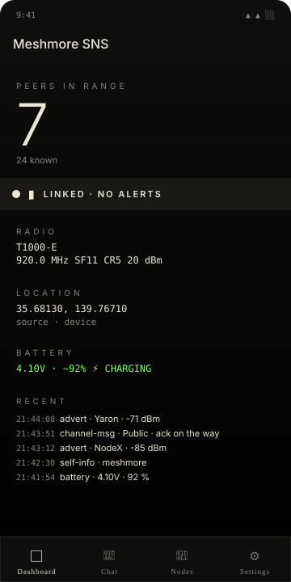
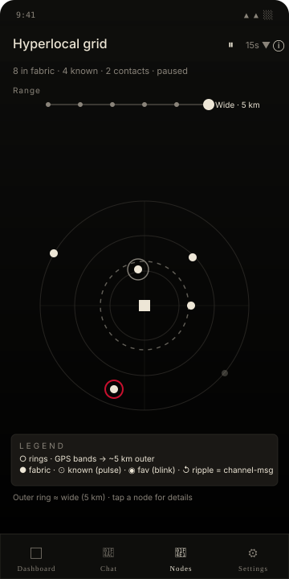
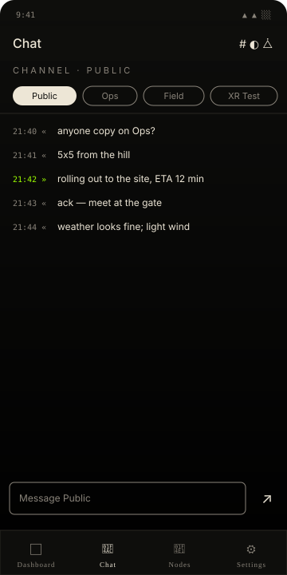
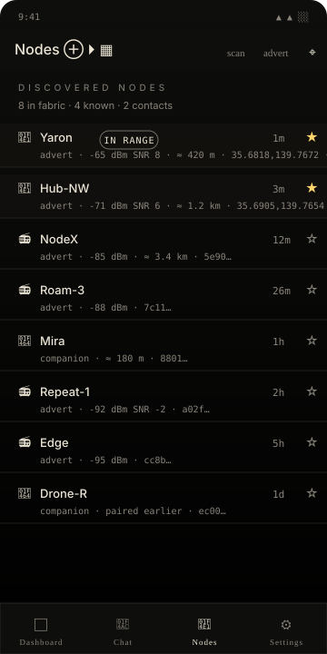
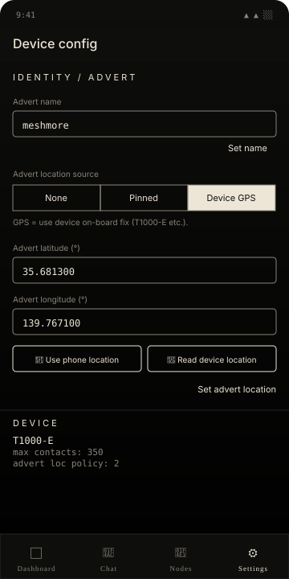

# Meshmore SNS

An **open-source Flutter client for the [MeshCore](https://github.com/ripplebiz/MeshCore) LoRa
mesh network** — a companion app for tracker/radio devices like the Seeed
**T1000-E** that pair over BLE and exchange messages over the local mesh.
Offline-first, theme-driven, with a hyperlocal radar grid, per-channel chat,
1:1 DMs, and a device-first → phone-fallback location model.

> **Status — in development.** Source is here for review and contribution;
> there's no public release channel yet. The one measured set of numbers lives in
> [`meshmore_sns_app/STATUS.md`](./meshmore_sns_app/STATUS.md), with the date and
> the command behind each, because a count restated in five documents goes wrong
> in four of them. Measured there on 2026-11-09: 2,338 widget and unit tests in
> three minutes, the protocol package's 382 with one skipped, the pure-Java
> port's 164 with none failing, and `flutter analyze` clean with no standing
> warnings. Debug and release APKs build, and the release bundle is 77 MB.
>
> Re-read on a motorola edge 2024 with a MeshCore radio paired: the shell's single
> header, the "Hyperlocal grid" tab, one rule per group boundary, the radio's
> contact table filling the node list on connect, a channel message sent and
> acknowledged, the vector basemap on the paper skin repainting on a preset
> switch, and the Japanese locale.
>
> Still owed: the ping round trip, the alarm's hold and cancel, a media transfer,
> the notification tap-through and the Doze run, all of which need a handset that
> nobody else is using. One dependency is not store-ready either: the bundled
> image codec's native library fails the 16 KB page requirement. What is not built
> at all is listed as residue in the feature register.

---

## Screens at this stage

Honest UI mockups in the **SEELE Monolith** default theme (still the default
preset). The drawings predate R116–R119, so the chrome in a current build
differs: the grid's transport and range are controls in a bottom bar (the
range is picked, not slid), the node row no longer carries an IN RANGE chip,
the app-bar strip uses 22 px icon cells, and the phone build now also has an
SOS and check-in surface, a pairing flow, a places layer over the map and a
media composer that none of these drawings show.

| Dashboard | Hyperlocal grid | Chat |
|:--:|:--:|:--:|
|  |  |  |
| PEERS IN RANGE numeral · status slab · LOCATION tile with `source · device` once GPS acquired · recent-events feed | Radial range-rings, GPS-or-RSSI positioning, pulse/blink for known/contact, tap-to-detail, Pause/Play interval, Range slider | Channel chip strip, per-channel TTS toggle, long-press → Reply / Copy / Delete locally |

| Nodes | Device config (Identity / Advert) | First-run permissions |
|:--:|:--:|:--:|
|  |  |  |
| Fabric list with per-node type + distance + signal line, favourite star, tap to detail | **Advert location source** (None / Device GPS / Pinned) + Use phone location / Read device location buttons | Proactive Bluetooth ask + first-class Offline path |

The UX design brief covers the six concept themes (NERV, AG-HUD, Hyperlocal,
SEELE, DR Pop, Recon) with palette anchors and per-theme rendering plans.

- **Design brief (Markdown):** [`meshmore-sns-UX-brief.md`](./meshmore-sns-UX-brief.md)
- **Design brief (HTML — has the per-theme SVG grid mockups):** [`meshmore-sns-UX-brief.html`](./meshmore-sns-UX-brief.html)

---

## What's built

The requirements, the change record and the sibling specs:

- **Requirements R1–R117 and their change record:** [`meshmore-sns-spec.md`](./meshmore-sns-spec.md). R118 onward are recorded in [`STATUS.md`](./meshmore_sns_app/STATUS.md), which is the live change log
- **UX implementation spec (U0–U15, six skins):** [`meshmore-sns-UX-spec.md`](./meshmore-sns-UX-spec.md)
- **Offline maps (R61, R93):** [`meshmore-sns-maps-spec.md`](./meshmore-sns-maps-spec.md)
- **Tools surface (R60):** [`meshmore-sns-tools-spec.md`](./meshmore-sns-tools-spec.md)
- **Radio chime and firmware alerts:** [`meshmore-sns-radio-alerts.md`](./meshmore-sns-radio-alerts.md)
- **MeshCore as a shared transport (protocol facts and the architecture of record):** [`meshmore-sns-meshcore-interop.md`](./meshmore-sns-meshcore-interop.md) (protocol facts) and [`meshmore-sns-architecture.md`](./meshmore-sns-architecture.md) (architecture of record), with the adversarial review in [`meshmore-sns-architecture-audit.md`](./meshmore-sns-architecture-audit.md) and the radio settings in [`meshmore-sns-radio-config.md`](./meshmore-sns-radio-config.md)
- **Telemetry and weather:** [`meshmore-sns-telemetry-research.md`](./meshmore-sns-telemetry-research.md), [`meshmore-sns-microclimate-wx.md`](./meshmore-sns-microclimate-wx.md)
- **Tracking and Meshbook earmarks:** [`meshmore-sns-geofence-tracking.md`](./meshmore-sns-geofence-tracking.md), [`meshmore-sns-meshbook-mbk.md`](./meshmore-sns-meshbook-mbk.md)
- **Status — what is built, what is open:** [`meshmore_sns_app/STATUS.md`](./meshmore_sns_app/STATUS.md)
- **Feature register (start here):** [`meshmore-feature-register.md`](./meshmore-feature-register.md)
- **The app specification — normative requirements with a check per row:** [`meshmore-app-spec.md`](./meshmore-app-spec.md)
- **Specification breadth review — what a complete spec needs beyond the feature list:** [`meshmore-spec-breadth-review.md`](./meshmore-spec-breadth-review.md)
- **Blocking a key — feature spec:** [`meshmore-sns-block-spec.md`](./meshmore-sns-block-spec.md)
- **SOS and check-in — feature spec:** [`meshmore-sos-spec.md`](./meshmore-sos-spec.md)
- **Places on the map — feature spec:** [`meshmore-places-spec.md`](./meshmore-places-spec.md)
- **Telemetry and coverage — feature spec:** [`meshmore-telemetry-coverage-spec.md`](./meshmore-telemetry-coverage-spec.md)

Highlights of what's already shipping:

- **Companion protocol over BLE** end-to-end: APP_START handshake, contact/advert
  ingestion, channel & DM send/receive, SET_ADVERT_NAME / SET_ADVERT_LATLON /
  SET_OTHER_PARAMS, auto-reconnect with backoff (R17), Android foreground service
  for background keep-alive.
- **Per-channel chat (R6)** + **1:1 DMs (R6 extended)** with persisted history,
  per-message Reply/Copy/Delete (R20), per-channel TTS toggle (R5).
- **Hyperlocal grid (R18 / U9)** — radial range-rings with hybrid GPS → RSSI →
  hash-bearing positioning, recency-fade brightness, pulse for *known*, rapid
  blink for *favourite*, anonymous-channel ripple, reduce-motion fallback,
  tap-to-select detail sheet, Pause/Play with selectable interval, six-stop
  Range slider (Room → Wide).
- **Device-first / phone-fallback location (R22)** — `SelfInfo.latitude/longitude`
  populate `mc.ownLocation` directly; if the device reports `(0, 0)` we fall back
  to a one-shot `geolocator` fix. Dashboard surfaces source + coordinates;
  Nodes rows show inline distance estimates.
- **First-run permissions UX (R21)** with proactive Bluetooth ask, just-in-time
  Notifications (only when "Stay connected in background" is enabled), and a
  fully-supported **offline mode**.
- **Per-theme presets** wired through tokens (`lib/theme/mm_tokens.dart`); the
  brief covers the visual identity per theme.
- **Diagnostics** screen with a bounded RAW FRAME LOG scroll (R23) for live
  protocol inspection.

- **Per-channel notifications (R24)** — each channel carries its own bundle
  (OS notification, sound, vibration, speech, mentions-only), edited from the
  channel row.
- **Documentation inside the app (R53, R86)** — a Docs hub with Protocol,
  Firmware, App and Devices bundled into the APK, so it reads offline, with an
  opportunistic refresh when the phone happens to be online.
- **Storage and backup** — Settings states what each store holds and what it can
  prove, and one history export produces a passphrase-encrypted file the same app
  restores.

Forward-looking but already speccd (not built):

- **R25** the equal-area cell overlay on the map. The standalone equal-grid view was
  removed; the density idea survives as the grid's **Message heat** view, and the
  per-cell map layer itself is unbuilt (register residue row).
- **R26** XR data streaming via private temp-URL reverse proxy.
- **R27** ~~Globe.GL macro view~~ — withdrawn 2026-11-05; the globe was removed
  from the product.

---

## Building & running

```bash
cd meshmore_sns_app/responsive_starter_app
flutter pub get
flutter run            # debug on a connected device
flutter analyze        # static analysis
flutter test           # the whole suite; the count is in STATUS.md
```

**Submodule note** — the `meshcore` codec lives at
`meshmore_sns_app/packages/meshcore` and is consumed via a `path:`
dependency in `pubspec.yaml`. Tests in the responsive app reach the
codec directly.

---

## Repository layout

```
meshmore-sns/
├── README.md                       ← this file
├── .github/workflows/ci.yml        ← the gates: codec, app, Java port
├── meshmore-feature-register.md    ← the single list of state (start here)
├── meshmore-app-spec.md            ← APP-* requirements, each with a check
├── meshmore-scope-of-record.md     ← decisions D8.x / D10.x / D11.x
├── meshmore-master-plan.md         ← the plan of record, §W1–§W12
├── meshmore-execution-plan.md      ← the wave order and what closes each item
├── meshmore-publishing.md          ← what a publisher must supply
├── meshmore-sns-spec.md            ← requirements R1–R117 + their change record
├── meshmore-sns-UX-spec.md         ← U0–U15 implementation plan
├── meshmore-sns-maps-spec.md       ← offline maps (R61, R93)
├── meshmore-sns-tools-spec.md      ← Tools surface (R60)
├── meshmore-sns-radio-alerts.md    ← radio chime in firmware, per-board matrix
├── meshmore-sns-UX-brief.md/.html  ← visual design brief
├── brand/                          ← logo work + mockup generators
│   ├── _app_screens.py             ← regenerates screens/*.svg
│   ├── _grid_mockup.py             ← per-theme grid mockups in the brief
│   ├── _render_plan.py             ← per-theme rendering plan in the brief
│   └── _apply_headers.py           ← MIT/SPDX header sweep
├── screens/                        ← README screen mockups
├── libmeshcore/                    ← the protocol codec ported to pure Java
├── libmeshcore-android/            ← the Android library wrapper for it
├── meshmore-xr/                    ← the Android XR companion (Kotlin)
├── meshmore-xr-www/                ← the XR project's Hugo site
└── meshmore_sns_app/               ← the Flutter project (tracked in this repo)
    ├── STATUS.md                   ← what is built, what is open, the change log
    ├── TOOLING.md                  ← the commands, and what each costs
    ├── packages/meshcore/          ← pure-Dart protocol codec
    └── responsive_starter_app/     ← Flutter app (Android is the target; iOS is kept, deprioritised)
        ├── lib/                    ← all controllers, screens, theme, perms…
        ├── assets/docs/            ← the four docs the app ships and reads offline
        ├── android/                ← FGS manifest, BLE perms
        ├── ios/                    ← Info.plist usage strings
        └── web/                    ← build only; no radio link, so it is not a supported target

There are no `linux/`, `macos/` or `windows/` runners. They existed so this app
could serve another application over the removed inter-app bridge, and they were
deleted with it.
```

---

## Attribution

### MeshCore (the protocol + the firmware this app talks to)

- **MeshCore project**: <https://github.com/ripplebiz/MeshCore> — the LoRa
  mesh-network protocol + firmware that runs on the radio devices this app
  pairs with (T1000-E etc.). Our [`packages/meshcore/`](./meshmore_sns_app/packages/meshcore/)
  is a Dart re-implementation of the companion-protocol codec, written against
  the public source.
- Hardware reference: **Seeed Studio T1000-E** tracker device used as the
  primary on-device test target.

### Flutter dependencies (all MIT / BSD / Apache-2.0)

| Package | Use |
|---|---|
| [`flutter`](https://flutter.dev) | Framework + Material widgets |
| [`provider`](https://pub.dev/packages/provider) | State + DI |
| [`go_router`](https://pub.dev/packages/go_router) | Routing |
| [`flutter_blue_plus`](https://pub.dev/packages/flutter_blue_plus) | BLE link to the MeshCore device |
| [`permission_handler`](https://pub.dev/packages/permission_handler) | OS permissions (Bluetooth, notifications, location) |
| [`geolocator`](https://pub.dev/packages/geolocator) | Phone-GPS one-shot fallback (R22) |
| [`flutter_foreground_task`](https://pub.dev/packages/flutter_foreground_task) | Android `connectedDevice` FGS for background keep-alive (R17 / U8) |
| [`flutter_tts`](https://pub.dev/packages/flutter_tts) | Text-to-speech for inbound channel messages (R5) |
| [`shared_preferences`](https://pub.dev/packages/shared_preferences) | Local prefs (theme, favourites, known set, first-run, chat history) |
| [`flutter_native_splash`](https://pub.dev/packages/flutter_native_splash) | Launch splash |
| [`cupertino_icons`](https://pub.dev/packages/cupertino_icons) | iOS-style glyphs |
| [`responsive_toolkit`](https://pub.dev/packages/responsive_toolkit) | Breakpoint helpers |
| [`package_info_plus`](https://pub.dev/packages/package_info_plus) | App version/build shown in About |
| [`intl`](https://pub.dev/packages/intl) | Locale + formatting |
| [`flutter_localizations`](https://api.flutter.dev/flutter/flutter_localizations/flutter_localizations-library.html) | L10n scaffolding (R4) |
| [`flutter_lints`](https://pub.dev/packages/flutter_lints) | Lint config (dev) |
| [`flutter_launcher_icons`](https://pub.dev/packages/flutter_launcher_icons) | Build-time icon generation (dev) |

### External tools / libraries referenced but not yet integrated

- [**OpenStreetMap**](https://www.openstreetmap.org/) raster tiles — one
  candidate basemap source for **R25** (future reverse-geocoded equal-grid map).
- [**Natural Earth**](https://www.naturalearthdata.com/), [**GeoNames**](https://www.geonames.org/) — public
  data sources we'd consider for a custom minimal tile DB (R25 alternative path).

### Design inspirations

The brief's six concept themes draw aesthetic inspiration from a range of
cultural / industrial sources. **No copyrighted assets are used** — palette
anchors, glyph language, and motifs are our own implementation in Flutter
tokens (`lib/theme/mm_tokens.dart`); the names below are credits for the
visual lineage:

- **NERV Terminal / SEELE Monolith** — *Neon Genesis Evangelion* (Khara).
- **AG-HUD Velocity** — *Aegis-class* combat-system HUDs (generic naval / pilot
  HUD idiom).
- **Hyperlocal Field** — sonar / hydrology display conventions.
- **DR Pop / Pure Phase** — halftone-pop poster idiom; the *shipped logo*
  builds from this concept.
- **Tactical Recon / Codec** — *Metal Gear* codec-screen idiom (Konami).

Type is bundled, not inherited: Saira (display and headings) and JetBrains Mono
(monospace, and the whole body of the technical skins) ship in
`assets/fonts/` and are declared in `pubspec.yaml`.

### Test fixtures + interop replay

Some test vectors under `packages/meshcore/test/vectors/` are captured from
public MeshCore traffic between reference firmware builds, used as
known-good interop fixtures. The captures are byte-for-byte
deterministic and contain no PII.

---

## License

[MIT](./meshmore_sns_app/LICENSE) — Copyright (c) 2026 IoTone, Inc.

The protocol codec at `meshmore_sns_app/packages/meshcore/` is published under the
same MIT license; see its [`LICENSE`](./meshmore_sns_app/packages/meshcore/LICENSE).
